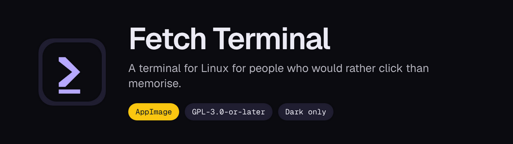
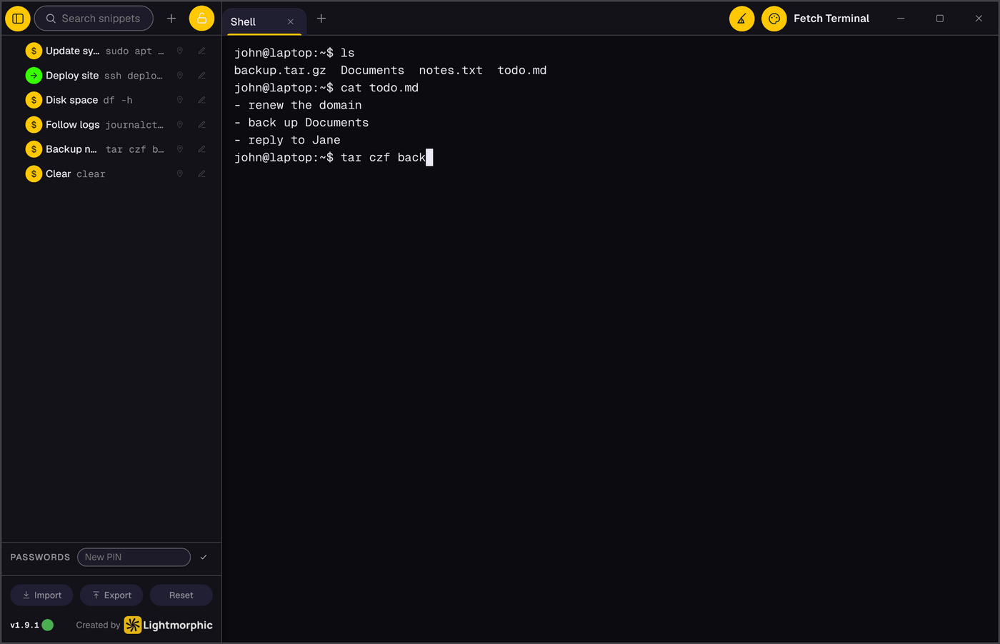
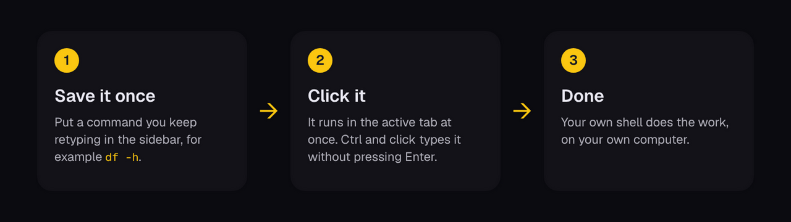
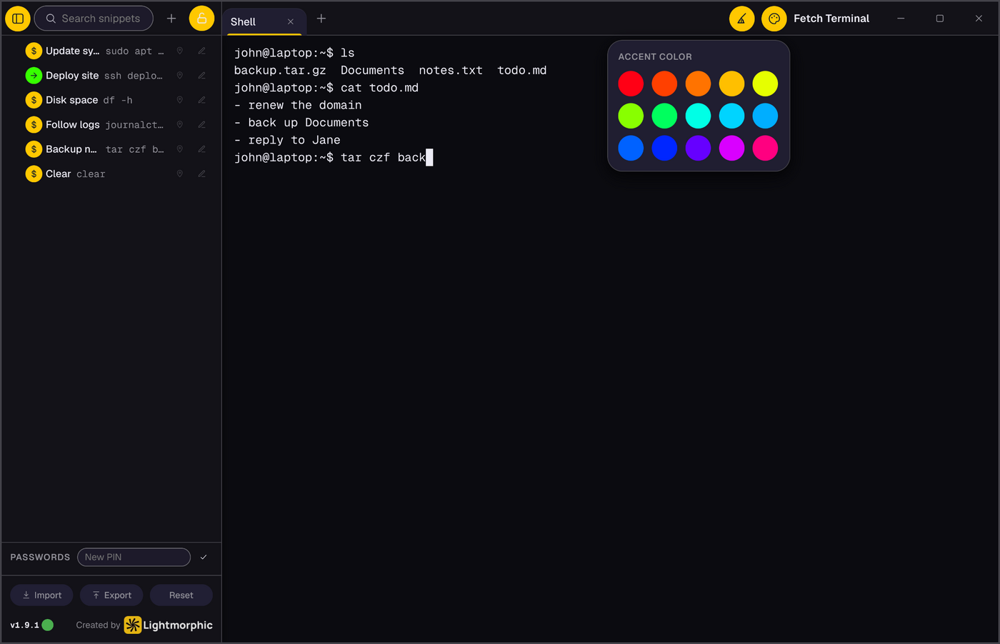

<p align="center">
  
</p>

<p align="center">
  <a href="https://github.com/gh-lm/fetch/releases"></a>
  <a href="LICENSE"></a>
  <a href="https://github.com/gh-lm/fetch/releases/latest"></a>
  
</p>

Fetch Terminal is a terminal emulator for the Linux desktop, built with
Electron. It draws its own interface, so it needs neither GTK nor Qt and looks
the same on every desktop.

Choose it if you keep retyping the same commands. Save a command once in the
sidebar and run it with a click, get your earlier commands offered as you
type, and keep passwords in a vault that types them for you without ever
showing them again.

<p align="center">
  
</p>

## How it works

<p align="center">
  
</p>

## Quick start

Download the newest AppImage from the
[releases page](https://github.com/gh-lm/fetch/releases/latest), then make it
executable and run it:

```sh
chmod +x Fetch-Terminal-*.AppImage
./Fetch-Terminal-*.AppImage
```

The first time it runs, it adds itself to your application menu, so you can
pin it to your panel like any other app. It needs no FUSE library, so it also
starts on systems that only have FUSE 3.

## Snippets

A snippet is a saved shell command, including an SSH one-liner. Click one and
it runs in the active tab. Hold Ctrl while you click to type it without
pressing Enter, which suits a snippet that is only the start of a command.

- A search box at the top of the sidebar filters as you type.
- Pin up to three snippets to the top of the list.
- Drag to reorder.
- The sidebar stays open by default. Unlock it and it folds away as soon as
  you type into the terminal or run a snippet.
- Export your snippets to a Markdown file and import them again, to back them
  up or share them.

## Your own colours

<p align="center">
  
</p>

The app is dark only. The palette button in the title bar opens fifteen accent
colours. Pick one and the buttons, icons, active tab and selection re-colour
at once, at full strength. The default is brand yellow.

## The password vault

Save a password once and click its row to type it into whatever is asking:
`sudo`, an SSH login, anything. The app presses Enter for you.

Passwords are write-only. Once saved, they can be used or deleted, but never
shown, copied or exported. Two things protect them:

1. **Encryption on disk.** Passwords are encrypted with your system's own
   keyring (Secret Service, GNOME Keyring or KWallet). If no keyring is
   running, saving fails with a clear message instead of storing the password
   in plain text.
2. **A vault PIN.** The PIN gates every use of the vault and locks it again
   after five minutes unused. Five wrong guesses lock it for an hour, and
   restarting the app does not reset that.

There is no way to recover a forgotten PIN. Reset all data is the way out, and
it deletes the saved passwords too.

## What it does

- Tabs running your default shell, up to four at once
- Inline autocomplete from your earlier commands. Accept with Tab or the
  right arrow
- A command history search, `Ctrl+Shift+F`, shared across tabs
- Multi-line paste that reaches the shell as one block. Nothing runs until you
  press Enter, and password prompts still work
- Click anywhere on the current input line to move the cursor there
- `Ctrl+Shift+C` and `Ctrl+Shift+V` to copy and paste, plus a right-click menu.
  Plain `Ctrl+C` and `Ctrl+V` keep their usual shell meaning
- Fifteen accent colours on a dark interface
- An update dot that checks hourly, and checks at once when you click it
- No accounts, no analytics, no telemetry

### Keyboard shortcuts

| Shortcut | Action |
| --- | --- |
| `Ctrl+Shift+T` | New tab |
| `Ctrl+Shift+W` | Close the active tab |
| `Ctrl+Tab`, `Ctrl+Shift+Tab` | Next or previous tab |
| `Ctrl+Shift+F` | Search command history |
| `Ctrl+Shift+B` | Show or hide the sidebar |
| `Tab` or right arrow | Accept an autocomplete suggestion |
| `Ctrl+Shift+C`, `Ctrl+Shift+V` | Copy and paste |
| `Esc` | Close an open dialog |

## Updates

The app asks GitHub for a newer release once when it starts and once an hour
after that. A small dot beside the version number shows the result:

| Dot | Meaning |
| --- | --- |
| Green | You are on the latest version. Click it to check now |
| Amber | An update is available. Click it to download, and a line traces the edge as it goes |
| Blue | The update is downloaded. Click it to restart into the new version |
| Grey | A check is in progress |
| Red | The last check could not reach GitHub |

Nothing downloads or installs unless you click. Updates only apply to the
AppImage. Running from source with `npm start` skips the check.

## Settings

Everything is set inside the app. There are no config files to edit.

| Setting | Required | Default | What it does |
| --- | --- | --- | --- |
| Accent colour | No | Brand yellow | One of fifteen colours, from the palette button in the title bar |
| Sidebar lock | No | Locked open | When unlocked, the sidebar folds away as you type |
| Vault PIN | Only to use the vault | None | Set the first time you open the vault |
| Reset all data | No | Not applicable | Deletes snippets, history, saved passwords and settings |

## Where your data lives

Snippets, command history, your accent colour and the encrypted vault are
JSON files in the app's folder under `~/.config/Fetch Terminal/`. Each one can
be read by your user account only. Nothing is sent anywhere.

To clear everything from inside the app, use **Reset** at the foot of the
sidebar and then **Confirm?**. To remove it by hand, after deleting the
AppImage:

```sh
rm -rf ~/.config/Fetch\ Terminal/
rm -f ~/.local/share/applications/fetch-terminal.desktop
rm -f ~/.local/share/icons/hicolor/512x512/apps/fetch-terminal.png
```

## Security

- The window only ever loads its own bundled interface. No remote content, no
  CDN, no web fonts.
- The Content Security Policy allows only the app's own scripts.
- Only `http` and `https` links are ever handed to your desktop to open.
- The only network request the app makes by itself is the update check.
- Every data file is readable by your user only.

The full policy, including how to report a problem privately, is in
[SECURITY.md](SECURITY.md).

## Building it yourself

You need Node.js and a toolchain for native modules, because `node-pty` is
compiled on install. On Debian and Ubuntu:

```sh
sudo apt install -y build-essential python3
```

Then, from a copy of this repository:

```sh
npm install
npm start
```

`npm run dist` builds `Fetch-Terminal-<version>.AppImage` and moves it into
`~/Downloads`.

### Snippet file format

Exported snippets are Markdown, so they are easy to read, edit and compare:

````md
# Fetch Terminal Snippets

## Deploy site
```sh
ssh deploy@example.com "cd /srv/app && ./deploy.sh"
```

```sh
ls -la
```
````

A `##` heading above a code block becomes the snippet's name. A bare code
block is imported without a name and shows its command as the label.

## Licence

Fetch Terminal is copyright Lightmorphic Ltd and free software under the GNU
General Public Licence, version 3 or later. The full text is in
[LICENSE](LICENSE). Versions 1.8.0 and later are under the GPL. Earlier
versions were released under the MIT licence. What changed in each version is
in [CHANGELOG.md](CHANGELOG.md).

To report a problem or ask a question, see [CONTRIBUTING.md](CONTRIBUTING.md).

## Disclaimer

This software is provided as it is, without warranty of any kind, express or
implied. The [LICENSE](LICENSE) file has the exact terms. You use it at your
own risk.
